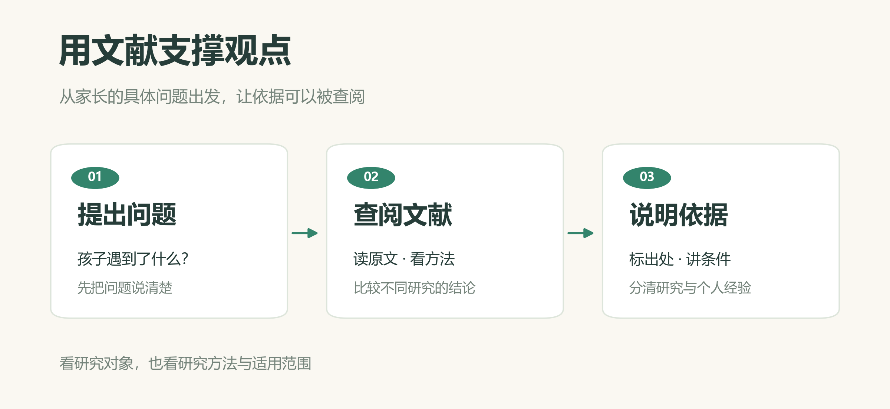
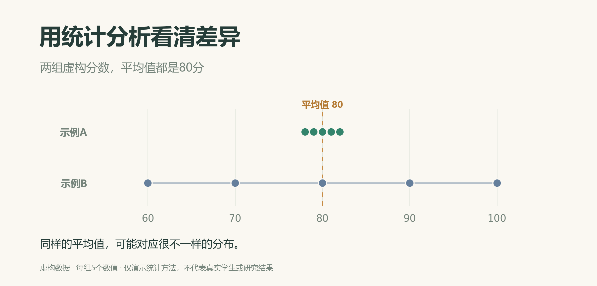

# 教育开篇

孩子如今已经上中学了。

回头看这些年的成长，感觉有不少事情值得记录下来。一路走来，有孩子自己的努力，有老师的教导，也有我和家人的共同投入。我们积累了一些经验，也有一些想法，随着孩子长大还在不断调整。

所以，我打算把这些经历和思考慢慢写下来，与同样关心教育的朋友交流。

我自己是博士，也写过SCI论文。做科研的经历，让我养成了遇到问题查文献、看数据、分析证据的习惯。接下来，我希望把这种方法用在教育写作中：**结合家庭经验，用研究文献和统计分析支撑观点，让重要的判断尽量有据可查。**

比如，孩子怎样安排学习，家长怎样参与，遇到学习上的困难如何分析，随着孩子长大，家庭的支持方式又该怎样变化。这些都是我想慢慢讨论的问题。

引用研究时，我会尽量读到原文，说明研究对象、研究方法和适用条件，并附上出处，方便大家核查。

涉及数据时，我会关注样本、比较口径和结果中的差异，再用清楚的图表解释。例如，两组分数的平均值都为80分，分布却可以很不一样。只看一个平均数，很容易漏掉这些信息。

一个家庭的经验、一项研究的结论，都有适用范围。我会尽量分清研究发现、家庭经验和个人判断；遇到不同证据，也会重新审视自己的想法。

涉及孩子的经历，我会注意保护隐私，只保留讨论问题所需要的背景。写作中也会尊重孩子的感受和意愿。

孩子在长大，作为家长，我也有很多需要学习的地方。把这些内容写下来，也是给自己做一次梳理。

希望这些分享，能给正在陪伴孩子成长的家长提供一点参考。也欢迎大家带着各自的经历和问题来交流。

就从这篇开始，慢慢写。
