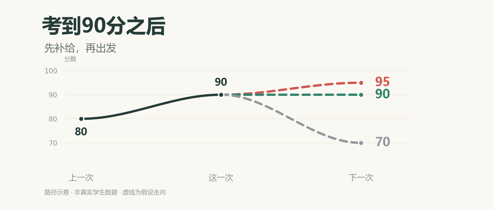

# 孩子进步了，先别急着加码

一个孩子，平时考80多分，这次突然考了90分。家长很高兴：“不错，争取下次95分！”

我觉得，先别急。

一次进步就等于能持续进步吗？

**孩子刚取得一次成功，先让他站稳、补给一下，再去挑战下一个目标。**

## 刚打赢石像怪，别残血去打飞龙

打游戏时，刚打赢一个Boss，拿到新成就，你会直接冲向下一关吗？

到底是完胜还是险胜？自己状态到底怎么样？是否已经残血了？

通常会先整理装备、补充药水，熟悉新的环境，再满血挑战下一个Boss。

**如果跳过中间的补给，直接残血去打飞龙，很可能通关失败，挫败感也跟着来了。**

**孩子的学习，也需要这样的补给：体会进步的快乐，弄清成功的原因，巩固刚学会的东西，恢复精力。**

**刚考90分就催95分，可能把这一步省掉了。**

## 先看清楚，这次90分怎么来的

**Barnett介绍的“均值回归”现象提醒我们：** 一次异常高的测量值如果包含偶然因素，后续结果可能不再那么极端。还要看看两次考试的难度、考查范围和评分尺度是否接近，以及孩子是否真正掌握了知识。一次90分，不能立刻变成以后每次考试的最低标准[[1]](https://doi.org/10.1093/ije/dyh299)。

同样的90分，原因可能很不一样：

- 积累终于见效，量变带来了质变，以前不会的题真的会了。
- 这次发挥得好，考到的恰好都会，没把握的题也蒙对了。
- 试卷更容易，或者考查内容正好是自己的强项。
- **甚至要考虑极端情况：这次的好成绩，是作弊得来的。**

这些情况对应的处理方式不同。真正掌握了，就巩固有效方法；发挥和运气占了较大成分，就补上没弄懂的部分；如果确实作弊，就要面对诚信和真实学习情况，不能把虚假的分数当成能力进步。

分析原因需要了解过程，不能只凭一次涨分下判断。

## 三个孩子的经历

以下经历来自身边朋友，使用A、B、C代称并省略部分身份细节。它们提供观察，不能单独证明教育方式与成绩变化的因果关系。

### A：前十还没站稳，就要前五

同学的女儿A，第一次进入班级前十。家长奖励了一台平板，紧接着又许诺：“下次进前五，再买一台iPad。”

后来，她没拿到iPad，成绩也越来越差。

原因可能不止一个。但第一次前十带来的喜悦，很快就变成了下一次前五的任务。她是否掌握了继续前进的方法，是否需要休息和巩固，还没来得及讨论。接连达不到新的要求，也可能消磨孩子继续努力的信心。

### B：从倒数到前十，努力两年

朋友的儿子B，刚上中学时，排名倒数。

他没有自暴自弃，开始发奋学习。第一年上学期末，年级排名上升了很多。家长没有要求他下次再涨多少，只希望保持眼前的学习节奏。

第一年下学期期中，排名回落一点，家长没有埋怨，仍然重视他有没有保持认真学习的习惯。到期末，他又有了明显进步。

**这样上升多一些、回落少一点，经过两年，他进入了年级前十。班主任把这个过程称为“螺旋上升”。**

这是一段实实在在的逆袭，但它需要时间。中间那些看起来没有继续上涨的阶段，也给巩固和积累留出了空间。

像打怪升级一样，每过一关，允许补给，再往前走。

### C：名次靠前了，更需要减压

朋友的女儿C，成绩一直很好，一次终于考到班级第一。下一次考试，班级名次有所回落，但年级排名仍在上升。家长却盯着稍微差一点的科目，追问为什么考差了。

到了优等生竞争激烈的阶段，名次越高，守住名次的压力往往也越明显：自己进步了，别人也在进步。家长更需要帮孩子缓解压力，看见整体进步，再一起分析具体问题。

Nathaniel汇总238项研究发现，考试焦虑与多种学业表现指标呈负相关[[2]](https://doi.org/10.1016/j.jad.2017.11.048)。这提醒我们，要留意孩子的焦虑，别让每次考好都变成更沉的负担。

## 知识掌握更重要

我儿子每次考完，我基本都会问：有没有不会的题？后来弄懂了吗？下次再出现，会不会做？

英国教育捐赠基金会（EEF）的反馈综述强调，反馈要具体、可以行动。这些证据主要来自教学场景，我把这个原则作为家庭交流的参考：一起弄清哪些题学会了、哪些方法有效，比只说“下次再多考几分”更有着落[[3]](https://educationendowmentfoundation.org.uk/education-evidence/teaching-learning-toolkit/feedback)。

所谓“稳住”，就是把已经掌握的知识和有效习惯留下来，不是要求下次分数只能升、不能降。

所以，面对一次进步，我更愿意先说：

> “这次进步了，真好。先休息一下，再看看这次做对了什么，哪些地方还需要巩固。”

庆祝、复盘、巩固、休息，这些都是补给。

**刚打赢一个Boss，先补给，再出发。**

---

## 参考资料

1. Barnett, A. G., et al. (2005). Regression to the mean: what it is and how to deal with it. *International Journal of Epidemiology, 34*(1), 215–220. https://doi.org/10.1093/ije/dyh299
2. von der Embse, N., et al. (2018). Test anxiety effects, predictors, and correlates: A 30-year meta-analytic review. *Journal of Affective Disorders, 227*, 483–493. https://doi.org/10.1016/j.jad.2017.11.048
3. Education Endowment Foundation. *Feedback: Teaching and Learning Toolkit*. https://educationendowmentfoundation.org.uk/education-evidence/teaching-learning-toolkit/feedback
