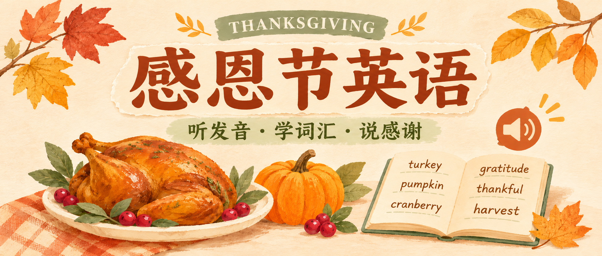
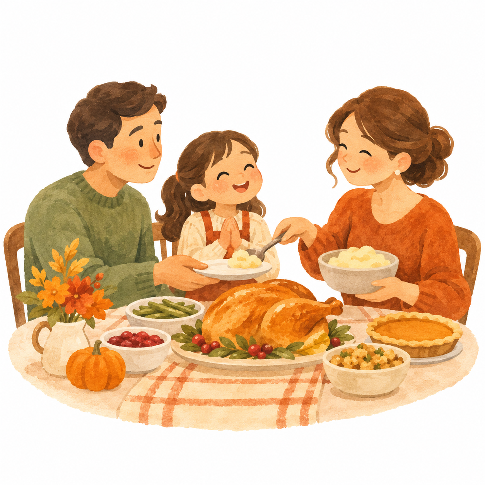
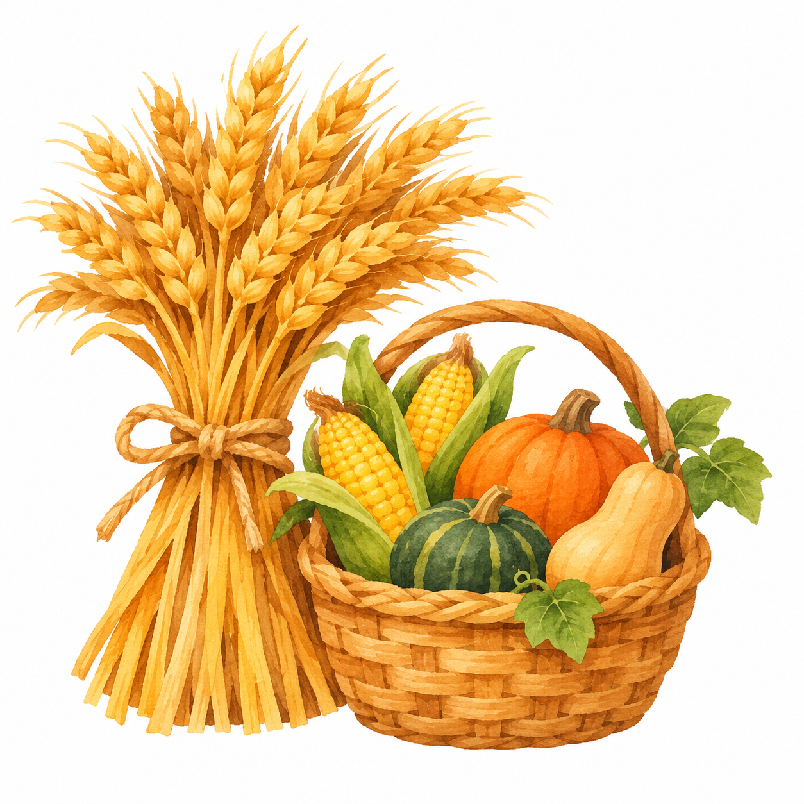
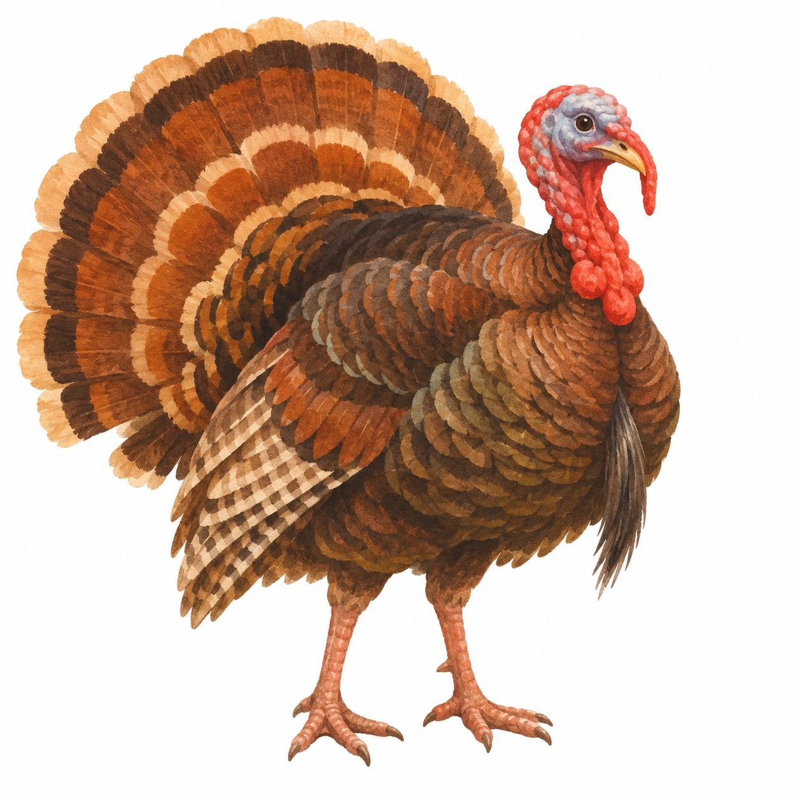
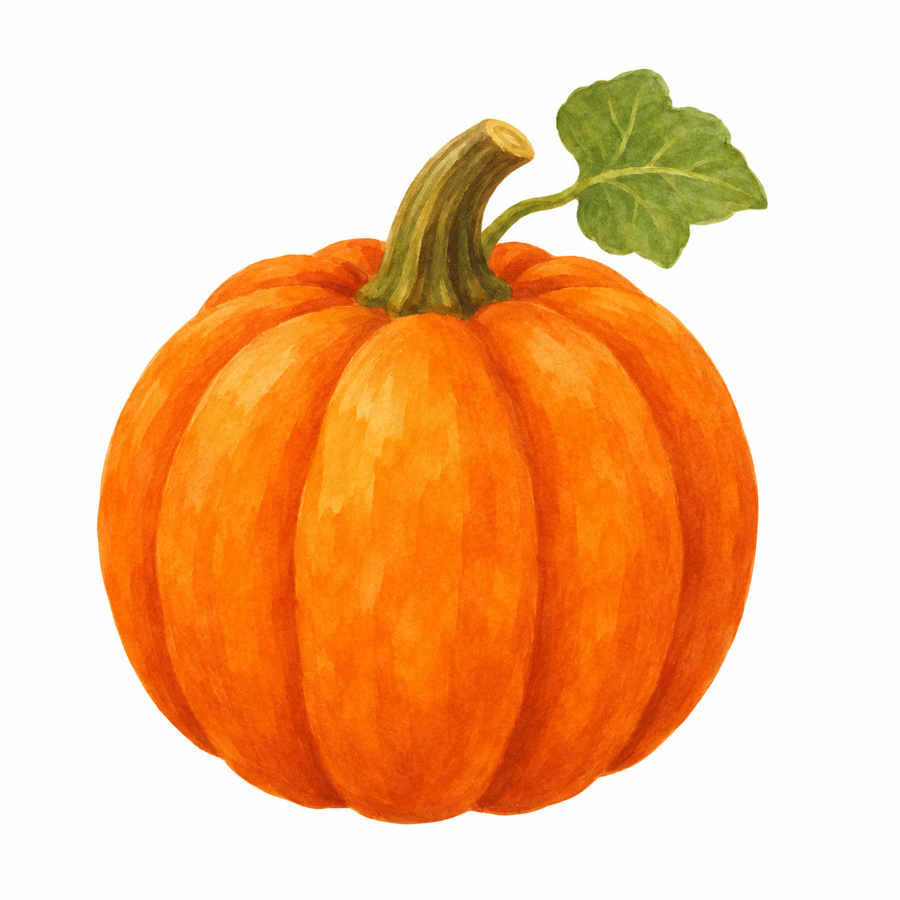
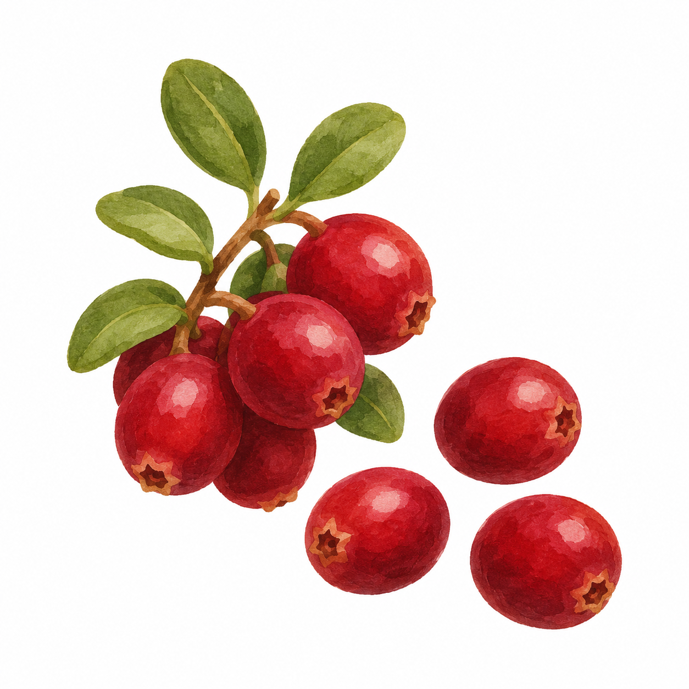
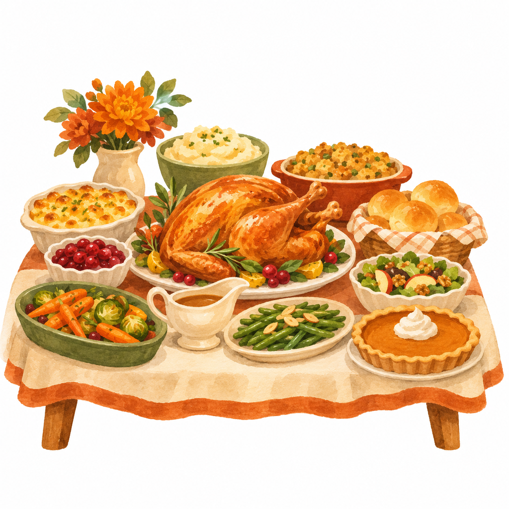
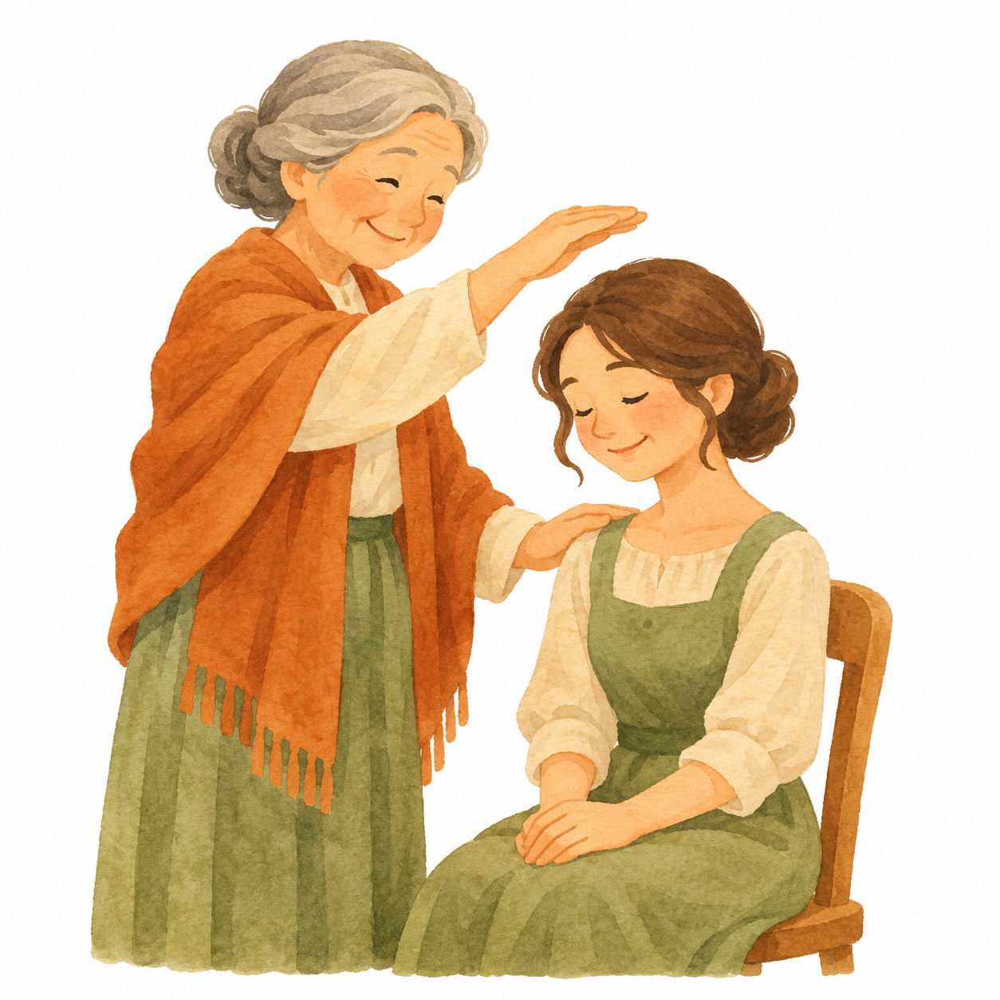
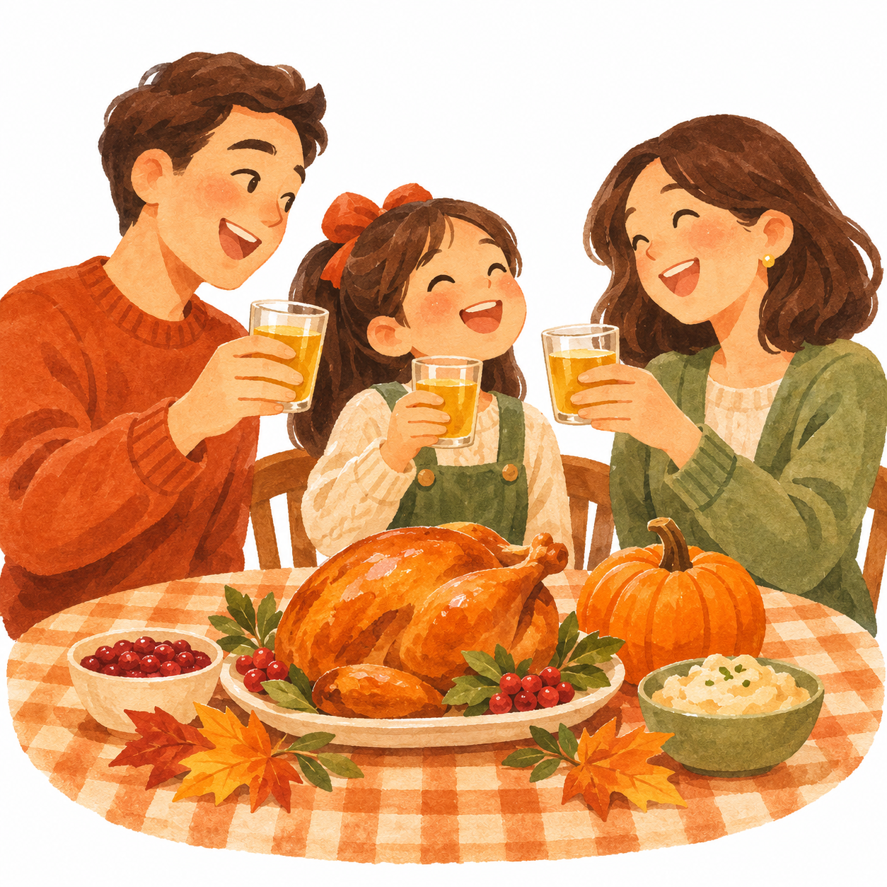

# 感恩节英语｜10个单词，把感谢说出来

感恩节，适合认识一种节日文化，也适合学着把感谢说具体。和孩子一起听一听、读一读这10个词吧。

## 日期怎么算？

美国感恩节定在每年11月的第四个星期四。计算时，找到11月的第一个星期四，再加21天即可，因此日期总在11月22日至28日之间。2026年是11月26日[1]。

## Where did Thanksgiving come from?

In the autumn of 1621, English settlers at Plymouth and Wampanoag people shared a harvest celebration. This gathering later became part of the story of Thanksgiving[2].

The national holiday developed over time. Abraham Lincoln proclaimed a national day of thanksgiving in 1863. In 1941, a law fixed the holiday on the fourth Thursday of November[4]. For some Native people, the day is also a time for mourning and remembrance[5].

**中文参考** 1621年秋，普利茅斯的英国殖民者与万帕诺亚格原住民共同庆祝丰收，这次聚会后来成为感恩节故事的一部分。全国性节日则逐步形成：1863年林肯宣布全国感恩日，1941年的法律固定了日期。对一些原住民而言，这一天也是悼念与追思之日。

### 从亲历者的书信读起

> our harvest being gotten in, our governor sent four men on fowling, that so we might after a special manner rejoice together …

收成入仓后，总督派出四人猎鸟，好让我们以一种特别的方式共同庆祝。

Edward Winslow, “A Letter Sent from New England,” 收于 Mourt’s Relation（伦敦，1622年），第61页。采用博物馆提供的现代拼写版本，节选22词[2][3]。

以上两段英文为据史料编写的简述，并非书中原文。书信摘录仅呈现殖民者视角。

## 节日与餐桌

###  Thanksgiving /ˌθæŋksˈɡɪvɪŋ/

**感恩节** 开头的 /θ/ 要轻轻送气，别读成 /s/。

[▶ Thanksgiving 发音](audio/01-thanksgiving.wav)

---

###  harvest /ˈhɑːrvɪst/

**收获；丰收** 从秋日丰收，想到一年里的成长与收获。

[▶ harvest 发音](audio/02-harvest.wav)

---

###  turkey /ˈtɝːki/

**火鸡** 美国感恩节餐桌上的代表性食物。

[▶ turkey 发音](audio/03-turkey.wav)

---

###  pumpkin /ˈpʌmpkɪn/

**南瓜** 做成南瓜派，是常见的节日甜点。

[▶ pumpkin 发音](audio/04-pumpkin.wav)

---

###  cranberry /ˈkrænberi/

**蔓越莓** 酸甜的蔓越莓酱，常用来搭配火鸡。

[▶ cranberry 发音](audio/05-cranberry.wav)

---

###  feast /fiːst/

**盛宴** 形容一顿丰盛的大餐。

[▶ feast 发音](audio/06-feast.wav)

---

## 把感谢说出来

###  thankful /ˈθæŋkfəl/

**感激的；心怀感谢的** 想到值得感谢的人和事，就可以用上它。

[▶ thankful 发音](audio/07-thankful.wav)

---

###  grateful /ˈɡreɪtfəl/

**感激的** 常用来表达对他人帮助的感谢。

[▶ grateful 发音](audio/08-grateful.wav)

---

###  gratitude /ˈɡrætətuːd/

**感激之情；感恩** 这是名词；前面两个词是形容词。

[▶ gratitude 发音](audio/09-gratitude.wav)

---

###  bless /bles/

**祝福；保佑（动词）** 为他人祈愿平安与幸福。

[▶ bless 发音](audio/10-bless.wav)

---

## 学会两句祝福与感谢

###  Happy Thanksgiving! /ˈhæpi ˌθæŋksˈɡɪvɪŋ/

**感恩节快乐！** 

[▶ Happy Thanksgiving! 发音](audio/11-happy-thanksgiving.wav)

---

###  I'm grateful for your help. /aɪm ˈɡreɪtfəl fər jʊr help/

**谢谢你的帮助。** 

[▶ I'm grateful for your help. 发音](audio/12-i-m-grateful-for-your-help.wav)

---

今天，试着说一句具体的感谢：“谢谢你听我说完”“谢谢你今天帮了我”。你最想把这句话送给谁？

词汇释义及读音参考剑桥词典[6]。 美式音标；音频为合成语音；封面与词汇插画为AI生成。

## 参考文献

[1] U.S. Office of Personnel Management. Federal Holidays: 2026 Holiday Schedule.
https://www.opm.gov/policy-data-oversight/pay-leave/federal-holidays/

[2] Edward Winslow. “A Letter Sent from New England.” In Mourt’s Relation. London, 1622, p. 61. 现代拼写转录见 Pilgrim Hall Museum, The “First Thanksgiving”.
https://www.pilgrimhall.org/thanksgiving-national-day-of-mourning/the-first-thanksgiving/

[3] Susan Hardman Moore. The Evolution of Thanksgiving. Yale University Press, November 27, 2014. 书目脚注[i]注明上述书信的版本与页码。
https://yalebooks.yale.edu/2014/11/27/the-evolution-of-thanksgiving/

[4] U.S. National Archives. Congress Establishes Thanksgiving.
https://www.archives.gov/legislative/features/thanksgiving

[5] National Museum of the American Indian, Smithsonian Institution. The “First Thanksgiving”: How Can We Tell a Better Story?
https://americanindian.si.edu/nk360/thanksgiving/

[6] Cambridge University Press. Cambridge Dictionary. 单词释义及美式读音参考。
https://dictionary.cambridge.org/
